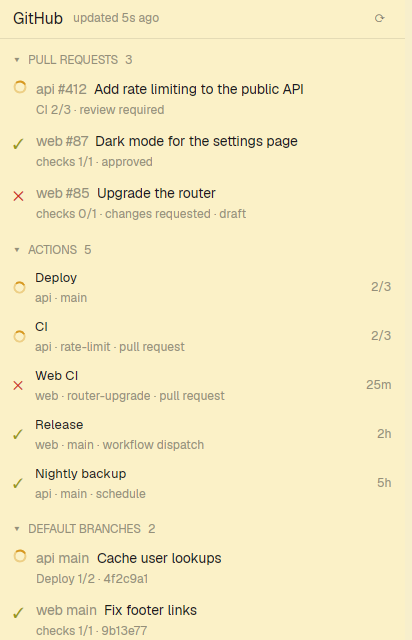

# gh-status

A [Herdr](https://herdr.dev) desktop-app mod: one side panel with your open GitHub pull requests, recent Actions runs and the CI status of your default branches. It refreshes by itself, so you stop reloading GitHub tabs.



- **Pull requests:** every open PR you authored, across repos, with review state, check progress and draft/conflict markers. Click a row to see its workflow runs and the jobs that failed or are running.
- **Actions:** the latest runs of your repos, running ones first, with job progress.
- **Default branches:** the checks on the head commit of each repo's default branch, for example a deploy after a merge.

Section headers hide and show their section, and the choice is remembered. Click a run or job to open it on GitHub.

## Needs

- The [GitHub CLI](https://cli.github.com), logged in (`gh auth login`). The mod uses your `gh` login and stores no token.
- Tested on Linux only so far.

## Install

Tell your Herdr agent:

> Read ~/.config/herdr-app/AGENTS.md, then add this mod: https://github.com/nikpopesku/herdr-gh-status

Or by hand, from a clone of this repo: `./install.sh` (copies `mods/gh-status/` into `~/.config/herdr-app/mods/` and runs `herdr-app check`).

Then put it in a layout of your own (Herdr's shipped layouts are read-only, so clone one first: `herdr-app do layout.clone '{"name":"main","as":"my-main"}'`). Add a block to the side panel's stack:

```json
{ "id": "gh", "type": "block", "content": { "mod": "gh-status", "props": { "repos": ["owner/repo"] } } }
```

The palette entry **GitHub status** also opens it as an overlay.

### Props

| Prop | Default | Meaning |
| --- | --- | --- |
| `repos` | `[]` | Extra repos (`owner/name`) for the Actions and Default branches sections. Repos with your open PRs are always included. |
| `poll_seconds` | adaptive | Fixed PR poll interval, minimum 5. Default: 10s while a check is running, 30s otherwise. |

### A toggle button next to Files and Changes

The panel shares the side stack with Files and Changes, and Herdr's tab bar only has buttons for those two. To get a **GitHub** button, clone the tab bar (`herdr-app do mod.clone '{"name":"tabs","as":"tabs-gh"}'`), point your layout's `tabs` block at `tabs-gh`, and in `mods/tabs-gh/main.js` add `"gh"` to the `enabled` list and a `panelButton("gh", "GitHub", "mods/gh-status/github.svg")` next to the Changes one.

## What it runs

- `gh api graphql` once per poll (rate-limit cost 1): your open PRs and the default-branch rollups.
- `gh api repos/<repo>/actions/runs` one repo at a time, every 60s while a run is in progress and every 5 minutes otherwise, only while the Actions section is shown; plus the jobs of up to 3 running runs per repo.
- `xdg-open` to open a link.

Errors double the wait up to 15 minutes; rate-limit errors wait at least 3 minutes. Polling pauses while the window is hidden.

## License

MIT
