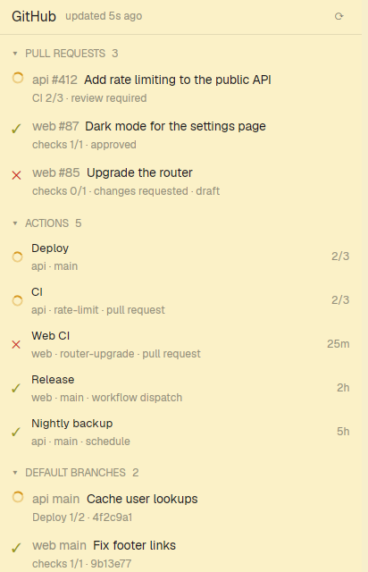

# gh-status

A side panel for the Herdr app that shows the person's open GitHub pull requests, the latest GitHub Actions runs of their repos, and the CI status of each repo's default branch. It refreshes by itself through the `gh` CLI, so nobody has to reload GitHub tabs.

## What you see

The mod fills its block on a `surface` background with `foreground` text. All colours come from `theme()` by name, so it follows any light or dark theme.

- **Header**, 36px high, 12px side padding, 1px `border` line underneath:
  - "GitHub" (semibold).
  - A status line in 11px, `dim`: `updated 12s ago`, `loading…` before the first answer, or the error in `ansi1` with `· retry 2m`.
  - At the right, a `⟳` button in `muted` (5px radius, `hover` fill). While a manual refresh runs, it is replaced by a 13px spinner.
- **Section headers**, 10.5px semibold `dim`, 12px side padding, 10px top / 4px bottom: `▾` (shown) or `▸` (hidden), the title in capitals, and a count. Sections in order: PULL REQUESTS, ACTIONS, DEFAULT BRANCHES (the last only when there is at least one branch).
- **PR row**, 12px side / 5px vertical padding, `hover` fill:
  - A 13px status icon.
  - Line 1, 12.5px: `<repo name> #<number>` in `dim`, then the title, truncated.
  - Line 2, 11px `dim`: progress, then review and markers joined by ` · `. Progress is `<workflow> <done>/<total>` while one run is running, `<n> runs <done>/<total>` for several, `checks <passed runs>/<runs>` when finished, or `no checks`. Review is `approved`, `changes requested`, `review required` or `no review`; markers are `draft` and `conflict`.
  - Expanded: one run row per workflow run (30px left padding, 11.5px, 11px icon, name in `muted`, `done/total` while running or the job count otherwise). Under a run that is not fully passed and has 2+ jobs, its failed or running jobs at 48px left padding, 11px `dim`, 10px icon.
- **Actions row**, 12px side / 4px vertical padding, `hover` fill: a 12px icon; the workflow name (12px); under it, 11px `dim`, `<repo name> · <branch>` plus the event when it isn't `push` (underscores become spaces); at the right, 11px `dim`, `done/total` jobs while running, else the age (`5m`, `3h`). At most 15 rows, running first, then newest first.
- **Default branch row**: same as a PR row, with `<repo name> <branch>` and the head commit's headline; line 2 ends with the short commit SHA.
- Empty states in 12px `dim`: "No open pull requests.", "No runs.", "Loading…", or the Actions error.

Icons: `✓` passed in `ansi2`, `✕` failed in `ansi1`, `–` neutral in `dim`, and running is `spinner.svg` turning once per 900ms in `working`.

## How it behaves

- Click a PR or default-branch row to expand or collapse its runs. Right-click it to open the PR (or the repo's Actions page). Click a run, job or Actions row to open it on GitHub.
- Click a section header to hide or show that section. The hidden set is saved in `localStorage` (`gh-status.hidden`). While ACTIONS is hidden, no Actions requests are made.
- The `⟳` button refreshes at once, at most once every 15 seconds.
- **PR query** (open PRs plus default branches): every 10s while any check is running, 30s otherwise. The `poll_seconds` prop fixes it instead, minimum 5.
- **Actions**: every 60s while a run is in progress, 5 minutes otherwise. When a PR or branch check starts running, Actions is fetched at once rather than waiting.
- On any error the wait doubles, up to 15 minutes. A rate-limit error waits at least 3 minutes; with no GraphQL points left, it waits until the reset time.
- Polling skips while the window is hidden (`window()?.visible === false`). A 5s timer drives everything and redraws every 15s so the "updated" age stays current. A poll that brings no change doesn't redraw.

## Built from

- `mods/gh-status/main.js` (the `View`), `query.js` (GraphQL text and parsing, no Herdr imports), `spinner.svg`, `github.svg`, `mod.json` (`place: "none"`, a palette entry "GitHub status" running `mod.open`).
- Props, read with `props()`: `repos` (extra `owner/name` repos) and `poll_seconds`.
- Data, all through `exec("gh", …)`, using the person's `gh` login:
  - `gh api graphql -f query=…` with `search(query: "is:pr is:open author:@me archived:false sort:updated-desc", type: ISSUE, first: 50)`. For each PR it reads the last commit's `statusCheckRollup.contexts(first: 100)`: `CheckRun` (name, status, conclusion, detailsUrl, `checkSuite.workflowRun { databaseId url workflow { name } }`) and `StatusContext`. It adds one aliased `rN: repository(owner, name) { defaultBranchRef { name target { ... on Commit { oid messageHeadline statusCheckRollup … } } } }` per repo, plus `rateLimit { remaining resetAt }`.
  - Check runs are grouped by workflow run (checks without one by name). A run is running if any job is, else failed if any failed, else passed. `SKIPPED`, `CANCELLED`, `NEUTRAL` and `STALE` count as neutral.
  - `gh api repos/<repo>/actions/runs?per_page=8` for each repo in turn, and `…/runs/<id>/jobs?per_page=50` for up to 3 running runs per repo.
- Repos for Actions and Default branches: the repos of open PRs plus `repos`, each matching `owner/name` with only `[A-Za-z0-9_.-]`.
- Links open with `exec("xdg-open", [url])`.

## Watch out

- Props are not passed to `init`: read them with `props()` from `"herdr"`. Reading the `init` argument leaves `repos` empty.
- Don't tie the Actions fetch to the PR poll's tick, or the first Actions load waits a whole PR interval.
- The Actions REST endpoint is the one GitHub's secondary rate limit hits first: keep it slow and sequential, never in parallel.
- `if (checking()) return;` in `init`, so `herdr-app check` doesn't call GitHub.
- Herdr's shipped layouts are read-only: the panel needs a cloned layout. The shipped tab bar has buttons only for Files and Changes, so switching to them hides this panel with no way back unless the tab bar is cloned and given a GitHub button (see the README).
- `xdg-open` is Linux; macOS needs `open` and Windows `explorer.exe`. Only tested on Linux.
- Limits: 50 PRs, 100 checks per PR, 8 runs per repo, 15 Actions rows shown.

## Done when

- `herdr-app check ~/.config/herdr-app/mods/gh-status` passes.
- With an open PR, its row shows the repo, number, title, review state and check progress, and expands to its runs.
- A run that starts on a listed repo appears under ACTIONS with a spinner and `done/total` within about a minute, and turns `✓` or `✕` when it ends, without clicking anything.
- Hiding ACTIONS stops Actions requests, and the hidden state survives reloading the mod.
- With `gh` logged out, the header says to run `gh auth login`.
- The unit tests (`node --test tests/*.test.mjs`) pass.
